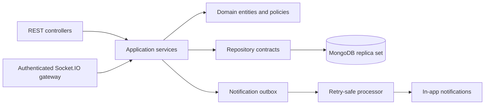
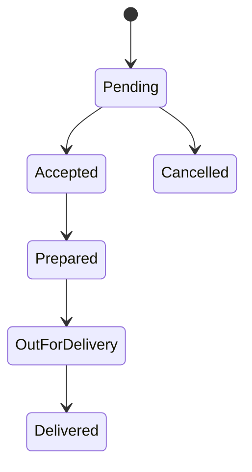

# Multi-Vendor Delivery Platform

[](https://github.com/Sye-1321/multi-vendor-delivery-platform/actions/workflows/ci.yml)

A tenant-aware NestJS backend for multi-vendor food ordering and delivery, designed around transactional ordering, concurrency-safe fulfilment, resource-scoped authorization, durable notifications, and authenticated real-time updates.

## Engineering Highlights

- **Atomic, server-authoritative checkout:** menu items and prices are resolved by the server; cart, order, timeline, and notification-outbox state commit in one MongoDB transaction.
- **Concurrency-safe fulfilment:** lifecycle changes use compare-and-set updates, while courier availability and assignment change atomically to prevent competing claims.
- **Durable notifications:** the outbox processor atomically claims events, deduplicates delivery, recovers stale locks, retries with exponential backoff, and dead-letters repeated failures.
- **Authorized real-time updates:** Socket.IO connections are authenticated and order-room subscriptions are checked against customer ownership, restaurant administration, or delivery-operator scope.
- **Refresh-token replay controls:** refresh tokens are stored as digests and atomically rotated; stale tokens are rejected without invalidating their successfully rotated replacements.
- **Operational visibility:** structured JSON logs carry correlation IDs and redact sensitive fields; separate liveness and database-readiness endpoints distinguish process health from MongoDB availability.

## Architecture



The application is a modular monolith: one deployable service with HTTP and WebSocket entry points, MongoDB persistence, and a durable notification processor. Internal module boundaries protect business behavior without adding unnecessary network boundaries.

### Main Modules

```text
src/
|-- bootstrap/          validated runtime configuration
|-- infrastructure/     authentication, context, persistence, logging, email
|-- user/               identity and profile workflows
|-- company/            restaurant-company administration
|-- restaurant/         restaurant ownership and operations
|-- menu/               restaurant menus
|-- menu-item/          tenant-scoped catalog items
|-- order/              checkout, lifecycle, timeline, and real-time updates
|-- delivery-person/    courier eligibility, claiming, and release
|-- notifications/      durable outbox and in-app notifications
|-- restaurant-review/  restaurant feedback
`-- system-review/      platform feedback
```

## Critical Workflows

### Transactional Checkout

The client supplies item identifiers, quantities, customizations, and a
delivery address. Prices and subtotals are never trusted from the request.

Checkout:

1. Loads available menu items within the selected restaurant.
2. Calculates totals in integer minor units.
3. Creates cart items, the cart, and the order with one MongoDB session.
4. Writes the initial timeline entry and notification intent in that
   transaction.
5. Publishes real-time state only after the transaction commits.

Any failure rolls the complete checkout back.

Checkout is cash-on-delivery only; the server does not collect an online
payment. New orders start with payment status `PENDING`, meaning payment has not
yet been collected. A successful delivery changes it to `PAID`.

Clients must give each intended checkout an opaque idempotency key:

```http
POST /api/v1/orders/<restaurantId>
Authorization: Bearer <access-token>
Idempotency-Key: <client-generated-key>
```

Retry the same checkout with the same key. Use a new key for a newly intended
order. Reusing a key with a different checkout payload returns `409 Conflict`.

### Order Lifecycle



Customers may cancel only a pending order and must supply a reason. Every
transition is a conditional database update: a competing request succeeds only
if the order still has the expected previous state.

### Courier Assignment

Courier availability and order assignment change in the same transaction. A
courier is claimed only when active, eligible for the restaurant's fulfilment
model, and currently available. Competing claims return a conflict instead of
double-assigning the courier.

### Durable Notifications

An order transition and its outbox intent commit together. The processor:

- atomically claims one due event;
- recovers abandoned processing locks;
- creates the in-app notification idempotently;
- retries failures with exponential backoff;
- moves repeated failures to dead-letter state.

This prevents committed order changes from silently losing their notification.

### Real-Time Order Updates

Socket.IO uses the `/orders` namespace and WebSocket transport.

Pass an access token either as `auth.token` or a Bearer authorization header,
then emit:

```json
{
  "event": "order:subscribe",
  "data": {
    "orderId": "MongoDB ObjectId"
  }
}
```

The socket disconnects when that access token expires. Clients must obtain a
fresh token through the HTTP refresh endpoint, reconnect, and resubscribe to
the required orders.

The server authenticates the socket, revalidates the persisted active account
and role, and authorizes the room against customer ownership, restaurant
administration, or operator scope. It then joins the room, reloads and
reauthorizes the current order, and returns that persisted snapshot as
`order:subscribed`. Clients should repeat this subscription on reconnect and
use the snapshot to recover updates missed while disconnected rather than
assuming earlier live events can be replayed.

Committed order changes are emitted as best-effort `order:updated` events. The
publisher and default Socket.IO rooms are in-process, so live broadcasts assume
one application instance: an update on one instance does not reach sockets on
another instance. Horizontal scaling would require shared Socket.IO/broker
infrastructure. These events are not a durable stream and are not replayed
after restart. If MongoDB commits but the process exits before publishing, the
state remains correct and the live event may be lost; reconnecting and
subscribing again recovers the current persisted state. The notification
outbox protects in-app notifications, not WebSocket replay.

## Business Model

The platform supports these operating arrangements:

- A company can manage one or more restaurant branches.
- Restaurant administrators manage restaurants that belong to a company.
- A restaurant can use its own couriers or request a courier from the shared delivery operator.

Standalone restaurants without company ownership are outside the current implemented scope.

Delivery personnel are coordinated by restaurant or delivery-company administrators. Direct courier accounts and GPS tracking are outside the current scope.

## Roles and Authorization

| Role | Main responsibilities |
| --- | --- |
| Customer | Browse restaurants, place and cancel orders, track progress, and submit reviews |
| Business administrator | Manage a restaurant company and its branches |
| Restaurant administrator | Manage a restaurant, catalog, orders, and restaurant-owned couriers |
| Delivery-company administrator | Manage shared couriers and platform fulfilment |
| System administrator | Perform platform-level administration |

Authorization combines role checks with resource ownership. Customer and restaurant order queries include their ownership scope in the database query, so another tenant's resource is not loaded before access is denied.

## API Overview

All REST endpoints use the `/api/v1` prefix.

| Area | Example routes |
| --- | --- |
| Health | `GET /health/live`, `GET /health/ready` |
| Authentication | `POST /auth/register`, `POST /auth/login`, `POST /auth/token/refresh`, `POST /auth/logout` |
| Profile | `GET /users/me`, `PATCH /users/me`, `PATCH /users/me/password` |
| Companies | `GET /companies`, `GET /companies/me` |
| Restaurants | `GET /restaurants`, `GET /restaurants/me`, `GET /company/restaurants` |
| Catalog | `GET /:restaurantId/menus`, `GET /me/menus`, `GET /:restaurantId/menu-items`, `GET /me/menu-items` |
| Orders | `POST /orders/:restaurantId`, `GET /orders/user/orders`, `GET /orders/restaurant/orders` |
| Notifications | `GET /notifications`, `PATCH /notifications/:notificationId/read` |
| Reviews | `GET /reviews`, `POST /restaurant-reviews/:restaurantId` |

Ordinary collection endpoints accept `limit` from 1 to 100 (default 20) and
`offset` greater than or equal to 0 (default 0). Notifications accept `limit`
from 1 to 50 (default 20) and an optional notification ObjectId in `before`.

Protected endpoints require:

```http
Authorization: Bearer <access-token>
```

## Technology

- Node.js 20+
- TypeScript
- NestJS 11
- MongoDB 7 and Mongoose
- Passport and JWT
- Socket.IO
- Winston
- Jest
- Docker Compose

## Local Setup

Requirements:

- Node.js 20 or newer
- npm 10 or newer
- Docker with Docker Compose

Clone and install:

```bash
git clone https://github.com/Sye-1321/multi-vendor-delivery-platform.git
cd multi-vendor-delivery-platform
npm ci
```

Create local configuration:

```bash
cp .env.example .env
```

The committed values are local-development examples. Replace all JWT secrets
and SMTP credentials outside local development.

Set `ACCOUNT_ACTION_BASE_URL` to the HTTP or HTTPS base URL of the client that
handles account actions, optionally including a path prefix (for example,
`http://localhost:5173/almost-there`). The client must implement the email
verification, registration completion, password reset, and email-change
callback pages. The API can start without this setting, but account emails
cannot be sent until it is configured.

Start the MongoDB replica set:

```bash
docker compose up -d
```

Before provisioning operators, confirm that MongoDB has elected a writable
primary:

```bash
docker compose exec -T mongodb mongosh --quiet --eval 'db.hello().isWritablePrimary'
```

Continue when the command returns `true`.

For a fresh database, temporarily add both privileged-operator credential
groups to `.env`:

- System administrator: `BOOTSTRAP_SYSTEM_ADMIN_NAME`,
  `BOOTSTRAP_SYSTEM_ADMIN_EMAIL`, `BOOTSTRAP_SYSTEM_ADMIN_PHONE`, and
  `BOOTSTRAP_SYSTEM_ADMIN_PASSWORD`.
- Delivery-company administrator: `BOOTSTRAP_DELIVERY_ADMIN_NAME`,
  `BOOTSTRAP_DELIVERY_ADMIN_EMAIL`, `BOOTSTRAP_DELIVERY_ADMIN_PHONE`, and
  `BOOTSTRAP_DELIVERY_ADMIN_PASSWORD`.

Then run:

```bash
npm run bootstrap:operators
```

This explicit CLI command creates only missing system and delivery-company
administrator roles as active users, hashes their passwords, and never
overwrites an existing role. It does not expose an HTTP bootstrap route. Remove
or unset the bootstrap password variables after provisioning.

Start the API:

```bash
npm run start:dev
```

The default API address is `http://localhost:4000/api/v1`.

Stop local infrastructure without deleting data:

```bash
docker compose stop
```

## Verification

Run the same quality gate used by CI:

```bash
npm run verify
```

It checks:

1. Prettier formatting
2. ESLint with zero warnings
3. Production compilation
4. Focused behavior tests

Run the MongoDB-backed integration suite against the local Compose database:

```bash
MONGODB_TEST_URI="mongodb://127.0.0.1:27018/?directConnection=true" npm run test:integration
```

CI runs both the focused tests and this integration command against its MongoDB
service. The integration suite covers authentication and account lifecycle,
transactional aggregate workflows, relationship integrity, concurrency,
operator bootstrap, collection pagination, notification continuation, and
order history.

The test suite intentionally protects high-risk boundaries rather than pursuing
a coverage percentage. Current checks cover readiness, request-context
isolation, cross-restaurant catalog selection, refresh-token replay, and
cross-customer WebSocket subscription.

## Operational Notes

### Uploaded media

Uploaded images are stored beneath the local `uploads/` root. API and database
values such as `restaurant-covers/<uuid>.png` are storage-relative media keys,
not absolute URLs. This Nest application does not expose `uploads/` as a static
route; deployments must persist or mount the directory and expose it through
their chosen reverse proxy, media host, CDN, or equivalent. Clients should
resolve returned keys against the deployment's configured media base URL.

- Transactions require the provided MongoDB replica-set configuration.
- JSON logs are written to the console and daily rotating files.
- Correlation IDs propagate through HTTP requests, order timelines, real-time
  events, and notification intents.
- Online payment processing, route optimization, GPS tracking, and courier
  mobile applications are intentionally not implemented.

## License

This repository is currently unlicensed. All rights are reserved.
